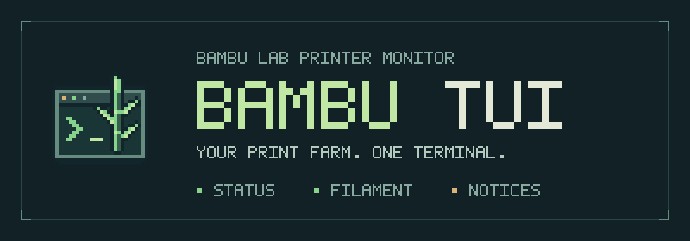
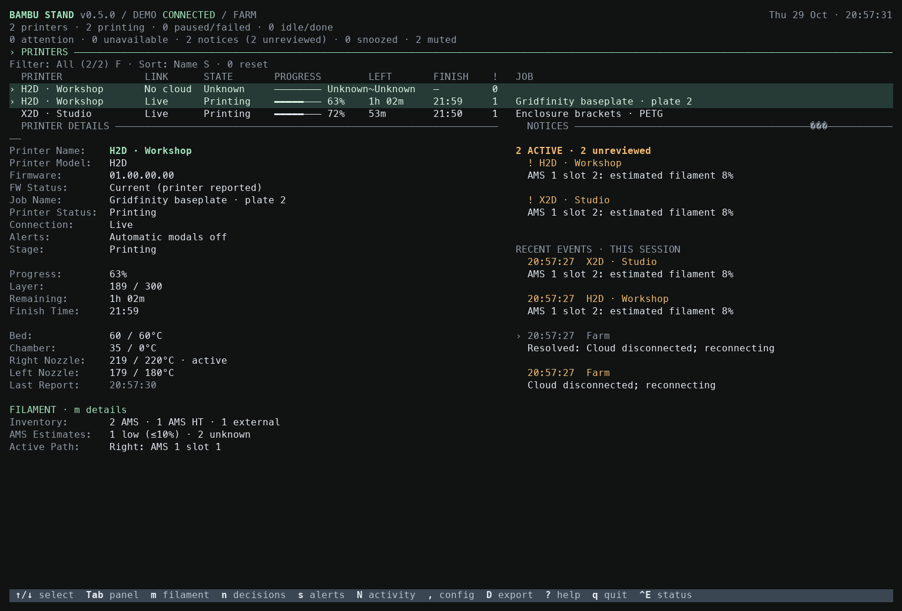
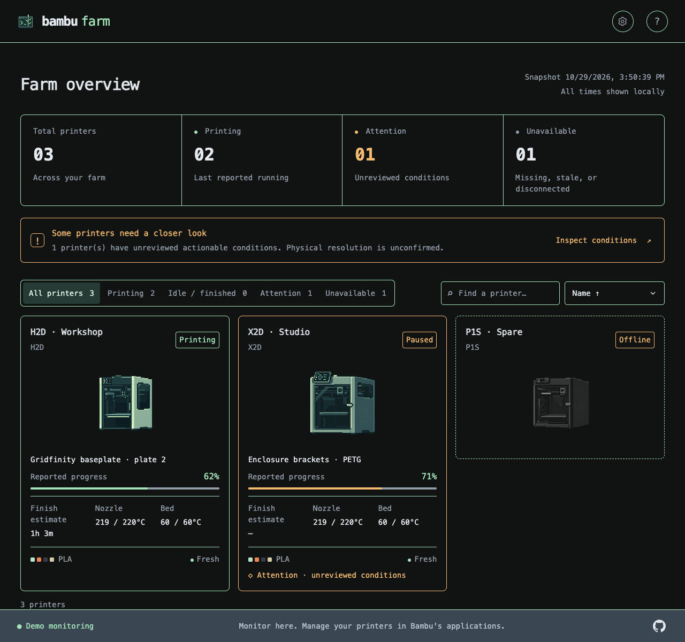
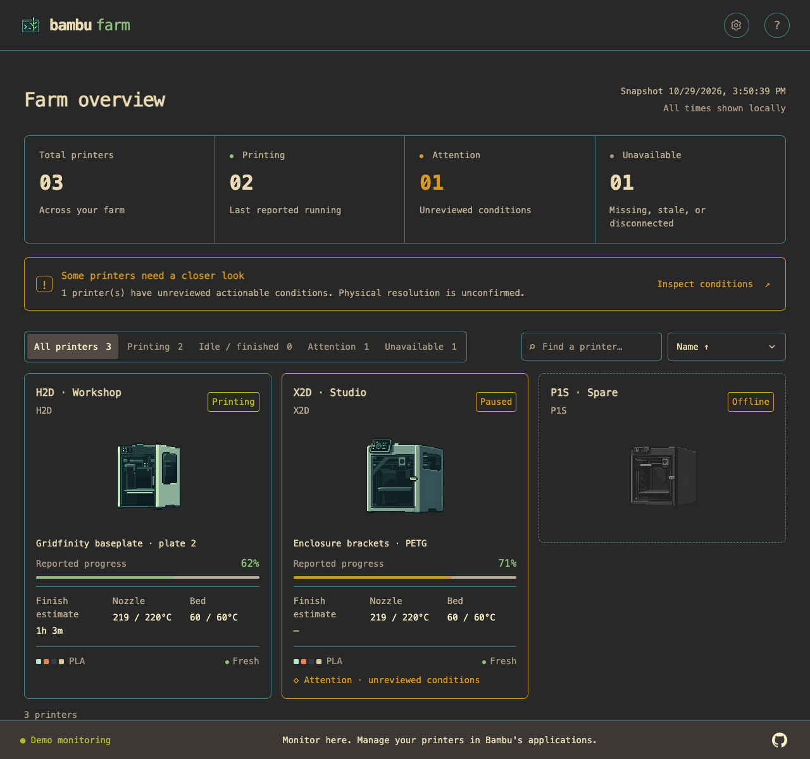
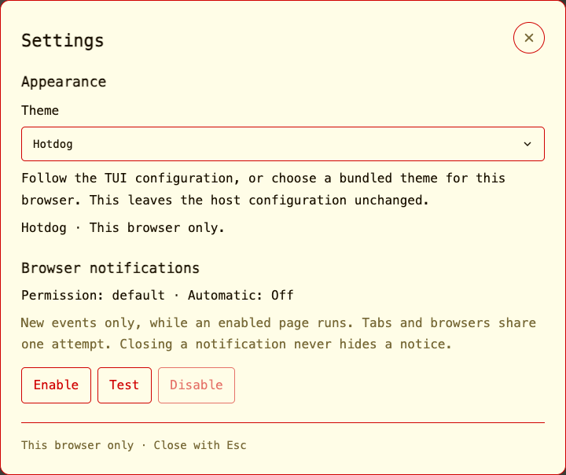

# Bambu TUI



[](https://github.com/cliffom/bambu-tui/actions/workflows/ci.yml)
[](https://github.com/cliffom/bambu-tui/actions/workflows/lint.yml)
[](https://github.com/cliffom/bambu-tui/releases/latest)

Monitor your Bambu Lab print farm **in your terminal or a local web browser**. See printer status, print progress, time estimates, temperatures, filament, and faults at a glance.

Bambu TUI connects through **Bambu Cloud**, with displayed telemetry validated on **H2D and X2D**. Both interfaces monitor printer telemetry and support local notice decisions, including browser hiding synchronized with the TUI. Printer control and LAN connections are outside the project's scope. Try a simulated farm without an account or printer.

## Your farm, two ways

### Terminal dashboard

A keyboard-driven workspace for your farm: move between printers, inspect job details and AMS filament, review action-needed notices, and set alert preferences. Built-in and custom themes let you make it your own.



### Web browser dashboard

A visual farm overview with searchable, filterable printer cards, model illustrations, progress, temperatures, and filament. Spot printers needing attention or showing unavailable data, then inspect their reported conditions. Unknown readings stay unknown. Stale readings are labeled last-known; offline cards show just printer identity and inactive artwork, with full details available through inspection.



Choose **Settings > Appearance** to follow the terminal theme or select a bundled theme for this browser. Settings also contains the separate, opt-in browser notification controls.

| Gruvbox Dark dashboard | Hotdog Settings |
| --- | --- |
| [](assets/screenshots/browser-theme-gruvbox-dark.png) | [](assets/screenshots/browser-themes.png) |

See the [browser screenshot gallery](docs/user/usage.md#browser-screenshots) for all six themes, filtering, printer details, filament, and mobile views. All browser captures use synthetic demo data.

The optional browser dashboard runs on the **same computer** and shares the TUI's monitoring connection. For real printers, keep the TUI running or use the [terminal-free cloud server](docs/user/usage.md#terminal-free-cloud-server) after saving a login. [Enable the browser dashboard](#open-the-browser-dashboard) after starting either the demo or your own farm.

## Get started

You need macOS or Linux and a terminal of at least **60 columns × 18 rows**. To monitor real printers, use a Bambu account with your printers already bound to it. Saved login sessions use macOS Keychain or Linux Secret Service; Linux needs `secret-tool` (usually in `libsecret-tools`) and a running Secret Service session.

### 1. Install

Download your archive and the checksums file from the [latest release](https://github.com/cliffom/bambu-tui/releases/latest):

| Machine | Archive suffix |
| --- | --- |
| Mac with Apple silicon | `macos_arm64.tar.gz` |
| Mac with Intel processor | `macos_amd64.tar.gz` |
| Linux with x86-64 processor | `linux_amd64.tar.gz` |
| Linux with ARM64 processor | `linux_arm64.tar.gz` |

Archives include the executable, a short installation guide, a configuration example, and license notices. No Go installation is needed for a prebuilt release.

From your download directory, set the release version below to the one you downloaded. This example uses the Apple silicon archive; change the suffix for your machine.

```sh
release_version=vX.Y.Z # Replace with the downloaded release's version.
archive="bambu-tui_${release_version}_macos_arm64.tar.gz"
shasum -a 256 "$archive"
# Compare with the matching line in bambu-tui_${release_version}_checksums.txt.
tar -xzf "$archive"
./bambu-tui --version
```

On Linux, you can use `sha256sum` instead of `shasum -a 256`. Keep the executable here or move it to a directory on your `PATH`.

For optional macOS desktop notifications, keep the included `Bambu TUI Notify.app` beside the executable when moving it. See [desktop notification setup](#desktop-notifications).

### 2. Try the demo

```sh
./bambu-tui --demo
```

Browse a simulated farm with AMS units and an external spool. Press `m` to inspect filament and `?` for help. A simulated runout demonstrates an action-needed alert about 15 seconds after launch. Close dialogs with `Esc`, then press `q` to quit.

For terminal-free monitoring of your own farm, save a login and run `./bambu-tui serve`. For a terminal-free synthetic browser demo, run `./bambu-tui serve --demo` and open the printed localhost URL. Stop the foreground server with `Ctrl+C`. See [demo server options and limits](docs/user/usage.md#terminal-free-demo-server).

### 3. Connect your printers

```sh
./bambu-tui login --email-code
./bambu-tui
```

Enter your Bambu account email and the emailed code when prompted. This also works for **Google-linked accounts** using the email bound to Bambu. For password login, use `./bambu-tui login`.

All printers on the account appear automatically. If saving the login session is unavailable, login opens a dashboard for the current session instead; see [login troubleshooting](docs/user/usage.md#login-and-saved-sessions). For Bambu's China region, [set `region = "china"`](docs/user/usage.md#configuration) before logging in.

## Using the terminal dashboard

Use arrows or `j` / `k` to select a printer, `Tab` to switch panels, and `?` for all controls. These shortcuts cover the main tasks:

| Key | Action |
| --- | --- |
| `F` / `S` | Cycle printer filters / sorting |
| `m` | Browse AMS units and filament |
| `Enter` / `f` | Inspect a selected notice / the printer's first active fault |
| `a` / `c` | Acknowledge / dismiss a notice locally |
| `n` | Manage saved notice decisions |
| `s` | View alert preferences and snooze/resume controls |
| `N` | Inspect notification activity/ownership; recheck paused delivery |
| `,` | Edit general settings, alerts, printers, and web server |
| `W` | Inspect live server status and grouped HTTP client activity |
| `D` | Preview and confirm a local diagnostic export |
| `Esc` | Close a dialog |
| `q` / `Ctrl+C` | Quit after closing dialogs |

Action-needed alerts highlight faults requiring intervention. Acknowledging or dismissing a notice changes only the TUI; it does not clear a printer fault or resume a print. Filament quantities are estimates, and firmware information reflects what the printer reports. See the [user guide](docs/user/usage.md) for controls, configuration, saved sessions, and telemetry details.

## Open the browser dashboard

With the demo or your own farm running in the terminal:

1. Press `,` to open **Config**, then use `Tab` to select **Web Server**.
2. Select **Enable web server** and press `Enter` to turn it on.
3. Once the server shows **Running**, open the displayed URL on the same computer: **http://127.0.0.1:8080** by default.

Use the browser's search, filters, and sort menu to explore your farm. Multiple tabs share the same monitoring session, and browser filters do not change your terminal preferences. Use the TUI to acknowledge notices, or hide notices locally from either interface; inspection alone does not change them.

The web server is **off by default**, and its enabled setting and port are saved for future launches. If port 8080 is busy, choose another port in Config and open the URL shown after it starts. Access is localhost only, without authentication; other users and programs on this computer can access it. Keep the TUI running, or start the foreground `serve` mode. See the [web dashboard guide](docs/user/usage.md#local-web-dashboard) for settings and troubleshooting.

## Desktop notifications

Optional desktop notifications are available on **macOS** and are **off by default**. Signed release archives include a Developer ID-signed and notarized `Bambu TUI Notify.app`; keep it beside `bambu-tui`. No Swift, Xcode, or Apple Developer membership is needed to run a prebuilt release.

In the TUI, press `,` to open Config, use `Tab` to select **Alerts**, and select **Test Notification**. Allow macOS permission when prompted, then enable **Desktop notifications** and optionally sound. Delivery requires a running TUI session on a local Mac. Linux desktop notifications are not supported. See [notification setup and troubleshooting](docs/user/alerts.md#live-desktop-notifications).

## Build from source

Requires **Go 1.27.3 or newer**, Git, and Make.

```sh
git clone https://github.com/cliffom/bambu-tui.git
cd bambu-tui
make demo   # build and try the simulated farm
make auth   # build and log in with an email code
make run    # build and open your farm dashboard
```

The executable is built at `bin/bambu-tui`. Farm monitoring and the browser dashboard work without a notification helper.

For desktop notifications from a source build on macOS, install Xcode Command Line Tools (for Swift) and **Python 3.10+**, then build the helper:

```sh
make notify-helper  # creates bin/Bambu TUI Notify.app
make run
```

The locally built helper is ad-hoc signed and needs no signing certificate or Apple Developer membership. `make run` and `make demo` use the helper beside the executable; they do not build or download it. Rebuild with `make notify-helper` after updating its source, then follow the [notification setup](#desktop-notifications) above.

See [contributing](docs/development/contributing.md) for development setup, tests, formatting, and linting.

## More information

- [Documentation index](docs/README.md): user guides, development, and references
- [Troubleshooting and diagnostic exports](docs/user/diagnostics.md)
- [Hardware validation and known gaps](docs/development/validation.md)
- [Roadmap](docs/ROADMAP.md) and [changelog](docs/CHANGELOG.md)
- [Report a bug or request a feature](https://github.com/cliffom/bambu-tui/issues)

Licensed under [MIT](LICENSE). Release archives include Go and dependency license notices. This project is not affiliated with Bambu Lab.
